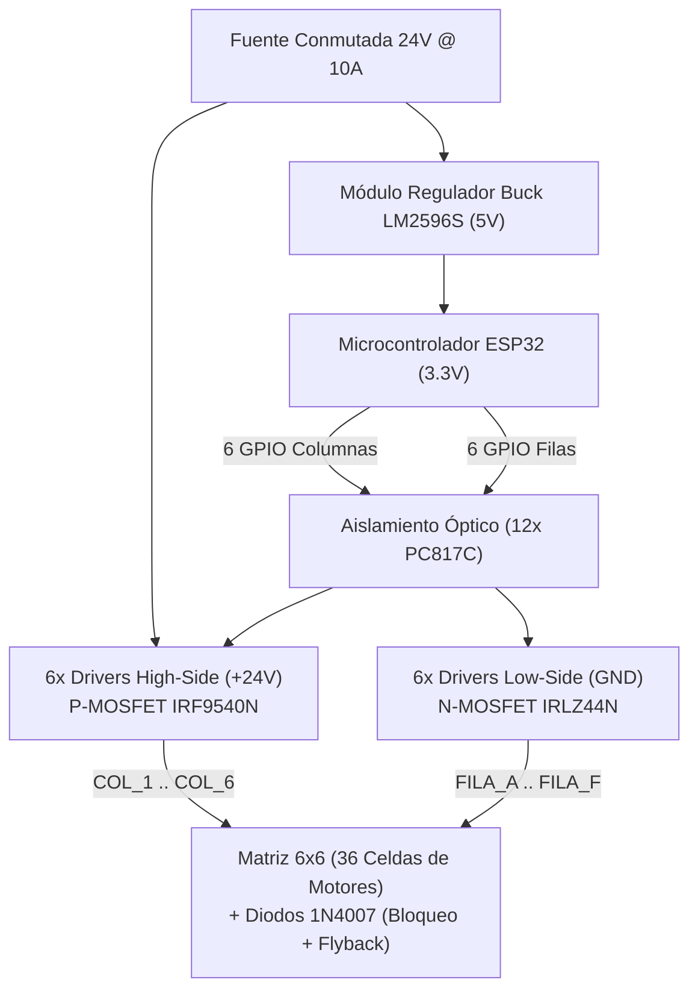

# REPORTE TÉCNICO DE INGENIERÍA: ELECTRÓNICA DE POTENCIA Y SISTEMA DE ACCIONAMIENTO MATRICIAL 6x6

**Proyecto:** Máquina Expendedora Inteligente ExpendeX  
**Institución:** Facultad de Ingeniería Mecánica y Eléctrica (FIME - UANL)  
**Sistema:** Etapa de Potencia y Control de Motores Espirales  
**Fecha de Emisión:** 19 de Octubre de 2026  

---

## 1. Resumen Ejecutivo y Objetivos

El subsistema de potencia de **ExpendeX** tiene como objetivo alimentar y conmutar de forma segura e independiente **36 micromotores reductores de 24 VDC** acoplados a las espirales dosificadoras de producto. Para minimizar la cantidad de líneas de control requeridas por el microcontrolador principal (**ESP32**), se diseñó una **arquitectura matricial 6×6 con conmutación bidireccional flotante (High-Side y Low-Side)**, logrando gobernar 36 actuadores utilizando únicamente **12 pines GPIO** con aislamiento óptico galvánico total.

---

## 2. Topología Matricial de Potencia (6×6)

### 2.1 Justificación Técnica
Un accionamiento individual directo requeriría 36 canales de relé o 36 MOSFETs dedicados, elevando drásticamente el costo, tamaño del PCB y complejidad del cableado.  
La solución matricial organiza los motores en una cuadrícula ortogonal:
* **6 Columnas High-Side (+24V):** Conmutadas hacia el riel de alimentación positivo mediante transistores P-MOSFET (**IRF9540NPBF**).
* **6 Filas Low-Side (GND):** Conmutadas hacia el retorno de tierra mediante transistores N-MOSFET (**IRLZ44NPBF**).

Un motor específico $M_{i,j}$ se activa **únicamente** cuando coinciden en conducción activa la columna $j$ (+24V) y la fila $i$ (GND). Los restantes 35 motores permanecen desenergizados o en circuito abierto.

---

## 3. Redes de Protección Eléctrica por Celda

Cada uno de los 36 nodos de motor cuenta con una red de doble protección integrada:

1. **Diodo de Bloqueo Anti-Crosstalk (en serie):** Diodo rectificador **1N4007** (1000V, 1A) en serie con el polo positivo del motor. Evita corrientes parásitas inversas (sneak paths) a través de la matriz cuando otros motores de la misma fila o columna conmutan.
2. **Diodo de Libre Circulación / Flyback (en paralelo inverso):** Diodo **1N4007** conectado en antiparalelo con el devanado inductivo del motor. Suprime picos de fuerza contraelectromotriz (Back-EMF) generados al desenergizar la bobina inductiva, protegiendo los transistores MOSFET contra avalanchas por sobrevoltaje inductivo.

---

## 4. Mapeo de Conexiones ESP32

Los 12 pines del ESP32 se conectan directamente a los ánodos de los optoacopladores mediante resistencias limitadoras de corriente de $330\,\Omega$ ($I_F \approx 6.5\text{ mA}$):

| Etapa | Designador | Pin ESP32 | Función Eléctrica | Actuador / Canal |
| :--- | :--- | :--- | :--- | :--- |
| **Fila Low-Side** | `FILA_A` | **IO13** | Activa Opto Fila A $\rightarrow$ IRLZ44N A $\rightarrow$ GND | Nivel 1 (Pisos 1-6) |
| **Fila Low-Side** | `FILA_B` | **IO12** | Activa Opto Fila B $\rightarrow$ IRLZ44N B $\rightarrow$ GND | Nivel 2 (Pisos 7-12) |
| **Fila Low-Side** | `FILA_C` | **IO14** | Activa Opto Fila C $\rightarrow$ IRLZ44N C $\rightarrow$ GND | Nivel 3 (Pisos 13-18) |
| **Fila Low-Side** | `FILA_D` | **IO27** | Activa Opto Fila D $\rightarrow$ IRLZ44N D $\rightarrow$ GND | Nivel 4 (Pisos 19-24) |
| **Fila Low-Side** | `FILA_E` | **IO26** | Activa Opto Fila E $\rightarrow$ IRLZ44N E $\rightarrow$ GND | Nivel 5 (Pisos 25-30) |
| **Fila Low-Side** | `FILA_F` | **IO25** | Activa Opto Fila F $\rightarrow$ IRLZ44N F $\rightarrow$ GND | Nivel 6 (Pisos 31-36) |
| **Columna High-Side** | `COL_1` | **IO33** | Activa Opto Col 1 $\rightarrow$ IRF9540N 1 $\rightarrow$ +24V | Columna Vertical 1 |
| **Columna High-Side** | `COL_2` | **IO32** | Activa Opto Col 2 $\rightarrow$ IRF9540N 2 $\rightarrow$ +24V | Columna Vertical 2 |
| **Columna High-Side** | `COL_3` | **IO23** | Activa Opto Col 3 $\rightarrow$ IRF9540N 3 $\rightarrow$ +24V | Columna Vertical 3 |
| **Columna High-Side** | `COL_4` | **IO19** | Activa Opto Col 4 $\rightarrow$ IRF9540N 4 $\rightarrow$ +24V | Columna Vertical 4 |
| **Columna High-Side** | `COL_5` | **IO17** | Activa Opto Col 5 $\rightarrow$ IRF9540N 5 $\rightarrow$ +24V | Columna Vertical 5 |
| **Columna High-Side** | `COL_6` | **IO16** | Activa Opto Col 6 $\rightarrow$ IRF9540N 6 $\rightarrow$ +24V | Columna Vertical 6 |

---

## 5. Lista de Materiales (Bill of Materials - BOM)

| Componente | Cantidad | Referencias en Esquemático | Encapsulado | Función | Código LCSC |
| :--- | :---: | :--- | :--- | :--- | :--- |
| **IRLZ44NPBF** | 6 | `Q_RA` a `Q_RF` | TO-220 | N-MOSFET Low-Side (55V, 47A, Logic-Level) | `C75882` |
| **IRF9540NPBF** | 6 | `Q_C1` a `Q_C6` | TO-220 | P-MOSFET High-Side (-100V, -19A) | `C2599` |
| **PC817C** | 12 | `U_OPTO_RA..RF`, `U_OPTO_C1..C6` | DIP-4 | Optoacoplador Galvánico 5 kV | `C76953` |
| **1N4007** | 72 | `D_BLK_A1..F6`, `D_FLY_A1..F6` | DO-41 | Diodo Rectificador / Protección 1000V 1A | `C64898` |
| **LM2596S-5.0** | 1 | `U_BUCK1` | TO-263-5 | Regulador Reductor Conmutado 24V $\rightarrow$ 5V 3A | `C29781` |
| **Resistor 330 $\Omega$** | 12 | `R_IN_RA..RF`, `R_IN_C1..C6` | THT / 0805 | Limitación de corriente LED Opto | `C17414` |
| **Resistor 10 k$\Omega$** | 12 | `R_GS_RA..RF`, `R_GS_C1..C6` | THT / 0805 | Resistencias Pull-Up / Pull-Down Gate MOSFET | `C25804` |
| **Resistor 4.7 k$\Omega$** | 6 | `R_PULL_C1..C6` | THT / 0805 | Polarización de colector optoacoplador | `C25900` |
| **Bornera 2 Pines** | 37 | `J_PWR_24V`, `M_A1..M_F6` | Pitch 5.0 mm | Conectores de potencia y salida a motores | `C8584` |

---

## 6. Cálculos de Eficiencia y Potencia Térmica

* **Corriente Nominal de Motor:** $I_{\text{nom}} = 0.35\text{ A}$ (a 24 VDC).
* **Corriente de Arranque / Bloqueo:** $I_{\text{bloqueo}} = 1.20\text{ A}$.
* **Resistencia en Conducción IRLZ44N ($R_{DS(on)}$):** $0.022\,\Omega$.
* **Pérdida por Conducción en el N-MOSFET:**
  $$P_{D(N)} = I^2 \times R_{DS(on)} = (1.20\text{ A})^2 \times 0.022\,\Omega = 0.0316\text{ W} = 31.6\text{ mW}$$
* **Resistencia en Conducción IRF9540N ($R_{DS(on)}$):** $0.117\,\Omega$.
* **Pérdida por Conducción en el P-MOSFET:**
  $$P_{D(P)} = I^2 \times R_{DS(on)} = (1.20\text{ A})^2 \times 0.117\,\Omega = 0.168\text{ W} = 168.5\text{ mW}$$
* **Conclusión Térmica:** Dado que un ciclo típico de dispensación dura aproximadamente $2.5\text{ s}$ por motor, la energía disipada es inferior a $0.5\text{ J}$. Los transistores operan a temperatura ambiente sin necesidad de disipadores de calor voluminosos, garantizando alta confiabilidad industrial.
