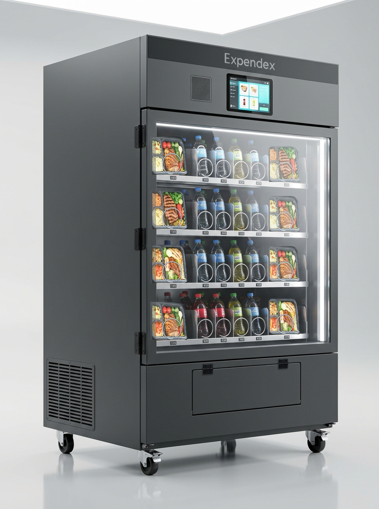

# ExpendeX® — Micro-Restaurante Automatizado Desatendido Híbrido

<div align="center">



**UNIVERSIDAD AUTÓNOMA DE NUEVO LEÓN**  
**FACULTAD DE INGENIERÍA MECÁNICA Y ELÉCTRICA (FIME)**  
*Coordinación General de Mecatrónica y Electrónica • Proyecto de Ingeniería Aplicada (IEA)*  
*Semestre Agosto – Diciembre 2026 • San Nicolás de los Garza, Nuevo León*

[]() [](LICENSE)
[](https://www.fime.uanl.mx)
[](04_FIRMWARE_ESP32_WOKWI/)
[](03_ELECTRONICA_POTENCIA_EASYEDA/)

</div>

---

## 👥 Equipo de Desarrollo y Matriz de Responsabilidades

| Integrante | Matrícula / Carrera | Rol Oficial en el Proyecto | Responsabilidades y Módulos Desarrollados |
| :--- | :---: | :--- | :--- |
| **Samuel Tovar Mújica** | **2077933**<br>IEA | **Jefe del Proyecto y Líder de Ingeniería Mecatrónica** | • Dirección general y concepción de la arquitectura del proyecto.<br>• **Modelado 3D CAD integral en Autodesk Fusion 360** (chasis monolítico, bandejas 1+4+1, espirales gigantes para tuppers de 650 g, ensamble cinemático y análisis modal/FEA).<br>• **Renders fotorrealistas oficiales y comerciales** de alta resolución (estudio, catálogo, campus e isometrías).<br>• **Simulación de electrónica digital y desarrollo de firmware en VS Code + PlatformIO + Wokwi** (ESP32 con FreeRTOS, escáner QR de Mercado Pago, pantalla HMI, teclado matricial y lógica de despacho).<br>• **Redacción técnica integral de todos los documentos académicos** (Actividades Fundamentales AF1, AF2, AF3 PIA, AF4 y AF5). |
| **Emiliano Sánchez Martínez** | **2012856**<br>IEA | **Integrante de Ingeniería Electrónica y Software** | • **Desarrollo de las plataformas web duales**:<br>&nbsp;&nbsp;- *Quiosco táctil del cliente* (pantalla de 10.1 pulgadas, catálogo de platillos calientes y bebidas frías, combos, desglose nutricional NOM-051 y cobro QR dinámico de Mercado Pago).<br>&nbsp;&nbsp;- *Panel administrativo del dueño* (telemetría en tiempo real, KPIs financieros a 60/90 días y gestión de inventario con rotación estricta FIFO).<br>• **Simulación y diseño de electrónica de potencia y ruteo PCB en EasyEDA** (matriz MOSFET 6×6, optoaislamiento PC817C, diodos Schottky 1N5822, relé de potencia de 30A y control termodinámico del compresor Embraco de 1/5 HP). |

---

## 📌 Descripción General del Proyecto

**ExpendeX®** es una máquina expendedora inteligente de última generación diseñada como un **micro-restaurante automatizado desatendido**. Rompe con el paradigma de las máquinas tradicionales de golosinas al incorporar una **arquitectura de bandejas híbrida 1+4+1 (36 canales)** capaz de almacenar y dosificar tanto recipientes gastronómicos de comida casera caliente (tuppers de hasta 650 g mediante espirales gigantes de Ø 144 mm) como botellas y latas de bebidas frías en sus canales centrales (espirales de Ø 70 mm).

### Características Técnicas Destacadas:
1. **Gabinete Monolítico Optimizado:** Altura limpia a 1,830 mm (techo plano industrial sin mástiles exteriores), cerramiento perimetral de chapa galvanizada Calibre 18 con acabado en pintura electrostática grafito mate, compuerta basculante sin manija y base móvil con 4 ruedas de alta carga con freno perimetral.
2. **Matriz de Conmutación de Potencia 6×6:** Control multiplexado de 36 motorreductores con solo 12 líneas GPIO del ESP32 mediante drivers High-Side (P-MOSFET IRF9540N) y Low-Side (N-MOSFET IRLZ44N) con optoaislamiento completo (PC817C) y diodos de bloqueo y supresión back-EMF (1N4007 / 1N5822).
3. **Firmware Multitarea ESP32 FreeRTOS:** Arquitectura dual-core con colas asíncronas de mensajes (`xQueueSend`), semáforos binarios y exclusión mutua para garantizar despacho libre de colisiones, confirmación óptica por haz infrarrojo y lectura 1-Wire del sensor térmico DS18B20.
4. **Refrigeración Comercial R134a:** Compresor hermético Embraco de 1/5 HP, condensador de tiro forzado, evaporador con desescarche automático y control termodinámico por relé de potencia de 30A con red de absorción snubber RC (100 Ω + 0.1 µF X2).
5. **Ecosistema Web Dual y Cobro Digital:** Quiosco táctil de 10.1 pulgadas para autoservicio con pasarela QR de Mercado Pago en tiempo real y panel de supervisión para el operador con rotación FIFO (First-In, First-Out) para garantizar la inocuidad alimentaria (NOM-251-SSA1-2009).

---

## 🗂️ Estructura del Repositorio

```text
├── 01_DOCUMENTOS_ACADEMICOS_FIME/           # Entregables académicos oficiales de FIME UANL
│   ├── AF1_Diseno_Prototipos_y_Experimentos... (PDF y DOCX)
│   ├── AF2_Presentacion_Resultados...         (PDF y DOCX)
│   ├── AF3_PIA_Reporte_Final...               (PDF y DOCX)
│   ├── AF4_Presentacion_Inicial_y_Costos...   (PDF y DOCX)
│   ├── AF5_Marco_Teorico_Modelacion...        (PDF y DOCX)
│   └── Presentacion_Final_Proyecto_ExpendeX... (PDF y PPTX)
│
├── 02_MODELADO_3D_CAD/                      # Modelado paramétrico tridimensional
│   ├── 02_MODELOS_3D_OBJ_STL_3MF/             # Mallas para manufactura aditiva y ensamble
│   └── 03_CAD_FUSION360_Y_AUTOCAD/            # Archivos paramétricos, planos y scripts
│
├── 03_ELECTRONICA_POTENCIA_EASYEDA/         # Esquemáticos, PCB y simulación SPICE
│   ├── SCH_ExpendeX_Matriz_6x6_MOSFET...      # Esquemático nativo EasyEDA (.json)
│   ├── PCB_ExpendeX_Matriz_6x6_MOSFET...      # Ruteo PCB multicapa (.json)
│   ├── BOM_ExpendeX_Matriz_6x6_JLCPCB.csv     # Lista de componentes con números LCSC
│   ├── potencia.html                          # Simulador web interactivo de conmutación 6x6
│   └── esquematicos_e_imagenes/               # Capturas de esquemático y detalles de bloques
│
├── 04_FIRMWARE_ESP32_WOKWI/                 # Código fuente C++ para ESP32
│   ├── src/main.cpp                           # Firmware con FreeRTOS y despacho matricial
│   ├── diagram.json                           # Simulación Wokwi (ESP32 + Matriz 36 LEDs)
│   ├── wokwi.toml                             # Configuración del entorno de simulación
│   └── platformio.ini                         # Dependencias y compilador PlatformIO
│
├── 05_PLATAFORMA_WEB_DUAL/                  # Software de gestión y quiosco HMI
│   ├── pagina_web_kiosco/                     # Frontend táctil para el usuario final
│   ├── user_interface_admin/                  # Dashboard administrativo y telemetría FIFO
│   └── servidor_y_bridge/                     # Servidor Node.js Express y puente serial
│
└── 06_RENDERS_OFICIALES_Y_COMERCIALES/      # Galería fotográfica y renders comerciales 8K
```

---

## ⚡ Simulación y Puesta en Marcha Rápida

### 1. Electrónica de Potencia y Matriz MOSFET 6×6
- Abre el archivo `03_ELECTRONICA_POTENCIA_EASYEDA/potencia.html` en cualquier navegador moderno para interactuar con la matriz de conmutación en tiempo real.
- Permite seleccionar cualquier celda (A1 a F6) para visualizar la activación coordinada de los MOSFETs High-Side y Low-Side, los pines del ESP32 activados y la corriente calculada.

### 2. Firmware y Simulación en Wokwi
- Abre la carpeta `04_FIRMWARE_ESP32_WOKWI` en **Visual Studio Code** con la extensión oficial de **Wokwi**.
- Presiona `F1` y selecciona `Wokwi: Start Simulator` para ejecutar el firmware en tiempo real con la matriz de 36 LEDs, display LCD I2C y consola serial.

### 3. Plataforma Web y Servidor Local
```bash
cd 05_PLATAFORMA_WEB_DUAL/servidor_y_bridge
npm install
node server.js
```
- Acceso Quiosco del Cliente: `http://localhost:3000/kiosco`
- Acceso Panel del Administrador: `http://localhost:3000/admin`

---

## 📜 Licencia y Cita Académica

Este proyecto ha sido desarrollado bajo los estatutos académicos de la **Facultad de Ingeniería Mecánica y Eléctrica (FIME)** de la **Universidad Autónoma de Nuevo León (UANL)**.  
Distribuido bajo la Licencia **MIT**. Consulte el archivo [LICENSE](LICENSE) para más detalles.
